# CredNotary design

This document explains what CredNotary protects, how the kernel changes credentials, how attacks bypass that protocol, how CredNotary detects each bypass, and how an attacker who knows about CredNotary can get around it. The [README](../README.md) covers building and running it. The diagrams are written in Mermaid, which GitHub renders in place.

1. [Credentials in the kernel](#1-credentials-in-the-kernel)
2. [When they change: the legitimate paths](#2-when-they-change-the-legitimate-paths)
3. [How attacks bypass the protocol](#3-how-attacks-bypass-the-protocol)
4. [How CredNotary works](#4-how-crednotary-works)
5. [Limitations and ways around CredNotary](#5-limitations-and-ways-around-crednotary)
6. [Events](#6-events)
7. [Code map](#7-code-map)

---

## 1. Credentials in the kernel

Every task has a `struct cred` that says who it is:
- **uid and gid**, each in four versions:
  - real: who started the process;
  - effective: used for permission checks;
  - saved: allows returning to an earlier uid;
  - filesystem: used for file access;
- the **supplementary groups**, shared through an immutable `struct group_info`;
- five **capability** sets:
  - *effective*: the ones in use;
  - *permitted*: the ones that can be enabled;
  - *inheritable* and *ambient*: the ones that survive an `execve`;
  - *bounding*: the upper limit;
- **`securebits`**, which control how capabilities follow uid changes;
- the owning **user namespace**: capabilities are valid only inside it.

A task has **two pointers** to a cred:
- **`real_cred`** (objective): who the task is when *others* act on it, for example when someone sends it a signal or traces it with ptrace.
- **`cred`** (subjective): who the task is when *it* acts, that is when it opens files or calls `capable()`.

The two pointers are usually equal. `override_creds()` temporarily changes only the subjective one, *within a system call*. overlayfs, NFS, `faccessat` and the io_uring workers do this, for example, to act with the credentials of whoever submitted the request. `revert_creds()` restores it before the return to user space.

**The golden rule: a published cred is never modified.** Creds are shared (a `fork` inherits them by reference) and read without locks through RCU. To change identity, the kernel therefore always follows the same protocol:
1. `prepare_creds()` makes a private copy of the current cred;
2. the kernel modifies the copy, which nobody else can see;
3. `commit_creds(new)` installs the copy on both pointers, or `abort_creds(new)` discards it.

## 2. When they change: the legitimate paths

**`setuid()` and similar calls** (`kernel/sys.c`, for example `__sys_setresuid`):
```
ns_capable_setid(CAP_SETUID)          <- needed only if the new uid is not
                                         one of the current three (real, effective, saved)
new = prepare_creds()                 <- private copy
new->uid = ... ; new->euid = ...
security_task_fix_setuid(new, old)    <- LSM hook: sees new BEFORE the commit
set_cred_ucounts(new)                 <- touches only the per-user counters
commit_creds(new)                     <- installation
```
`setgid` (`task_fix_setgid`), `setgroups` (`task_fix_setgroups`) and `capset` (`capset`) follow the same pattern.

**`execve()`** (`fs/exec.c`):
```
prepare_bprm_creds()                  <- private copy in bprm->cred
security_bprm_check()                 <- hook: the file to execute is known
begin_new_exec():
  bprm_creds_from_file()              <- setuid/setgid bits of the file and file capabilities:
                                         here a setuid-root binary becomes euid 0, and
                                         cap_bprm_creds_from_file computes the new capabilities
                                         pP' = (X & fP) | (pI & fI) | pA'
  ... point of no return ...
  security_bprm_committing_creds()    <- hook: sees bprm->cred BEFORE the commit
  commit_creds(bprm->cred)
```

**`fork()`**: `copy_creds()` gives the child a copy of the parent's cred, with the same contents, made with `prepare_creds()` and installed directly, without `commit_creds`; only threads (`CLONE_THREAD`) share the same cred. The `task_alloc` hook runs after `copy_creds()`, while the child is being built.

**`unshare(CLONE_NEWUSER)`**: creates a new cred in the new user namespace and installs it with `commit_creds`. Inside the namespace the process is "root", but its capabilities are valid only there: with respect to the initial namespace this is not a gain.

**Every legitimate privilege gain goes through an LSM hook that sees the exact cred before `commit_creds` installs it.** CredNotary is built on this fact.

## 3. How attacks bypass the protocol

An attacker with a kernel primitive (a memory write or control of the control flow) reaches root in one of four ways:

| | What it does | What it skips | Typical example |
|---|---|---|---|
| **G1** | calls `commit_creds()` on a privileged cred without going through a decision hook, or writes into the already approved cred between the hook and the commit | the LSM decision hook | ROP payload `commit_creds(prepare_kernel_cred(...))` |
| **G2** | overwrites the cred fields (uid, capabilities, groups) in place | everything: no copy, no commit | data-only attacks |
| **G3** | makes `real_cred` and/or `cred` point to another, privileged cred | everything | DirtyCred (swap of cred objects) |
| **G4** | overwrites `modprobe_path` or `core_pattern`: the kernel will run the attacker's program as root | does not touch the creds | usermode-helper hijack |

The next figure follows each class from the attacker's write to the point where CredNotary responds. G1, G2 and G3 end in the same place: the next LSM checkpoint of the task, which is the first operation that would use the stolen privileges. G1 is noticed earlier, at the commit, but a program attached to `commit_creds` cannot stop the commit, so the denial also happens at a checkpoint. G4 leaves the credentials alone and is stopped when the helper thread tries to execute the attacker's program.

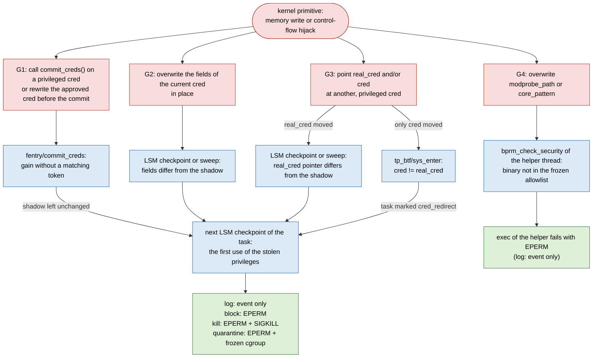

Section 4 explains each step of the figure; section 5 lists the routes that this figure does not cover.

## 4. How CredNotary works

For every task, CredNotary keeps a copy of the last credentials that the kernel's own checks approved, and compares the task's live credentials with that copy before the task uses them. This section first shows the pieces and when they run (4.1–4.3), then the per-task state and the two functions that do most of the work (4.4–4.5), and then how each class is caught (4.6–4.12).

### 4.1 Architecture

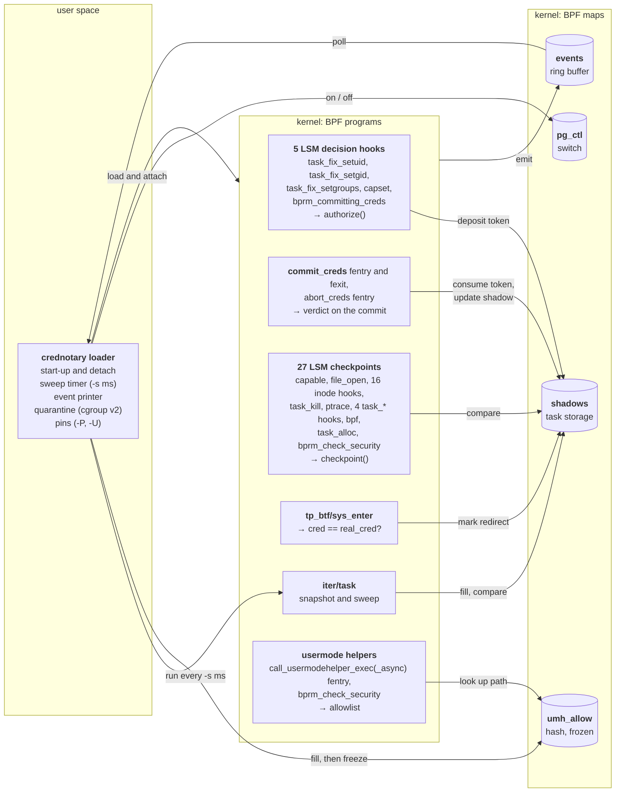

CredNotary has three parts:
- **The loader** (`src/crednotary.c`), a user-space program that runs as root. It loads and attaches the BPF programs, fills and freezes the helper allowlist, takes the initial snapshot, runs the periodic sweep, prints the events and, in quarantine mode, moves compromised processes into a frozen cgroup. It takes no security decision. The one action it performs on the kernel's behalf is the SIGKILL for tasks found by the sweep, on kernels where BPF cannot send it.
- **The BPF programs** (`src/crednotary.bpf.c`), 40 on Linux 7.3.1. They decide and enforce inside the kernel, in the context of the task being checked, so enforcement does not wait for the loader. The two iterators are the exception: they run when the loader asks.
- **The maps.** `shadows` holds the per-task state (4.4), `events` carries the events to the loader, `umh_allow` is the helper allowlist, and `pg_ctl` is the on/off switch that every rule reads first (4.3).

The programs fall into six groups:

| Group | Programs | Role |
|---|---|---|
| Decision hooks | 5 LSM: `task_fix_setuid`, `task_fix_setgid`, `task_fix_setgroups`, `capset`, `bprm_committing_creds` | check the task, then deposit a token for the new cred: `authorize()` |
| Commit | `fentry`/`fexit` `commit_creds`, `fentry` `abort_creds` | judge every credential install against the token and the shadow |
| Checkpoints | 27 LSM: `capable`, `file_open`, 16 inode hooks, `task_kill`, `ptrace_access_check`, 4 `task_*` hooks, `bpf`, `task_alloc`, `bprm_check_security` | compare the live cred with the shadow before a sensitive operation: `checkpoint()` |
| System call entry | `tp_btf/sys_enter` | detect a redirected subjective cred |
| Iterators | `iter/task` snapshot and sweep | fill the shadows at start-up; recheck every task periodically |
| Usermode helpers | `fentry` `call_usermodehelper_exec` and `call_usermodehelper_exec_async`, plus `bprm_check_security` | let helper threads execute only allowlisted binaries |

On kernels without `task_fix_setgroups` (before 6.1) a `fentry/set_groups` program replaces that hook. The `-DPG_SHADOW_HASH` build adds `lsm/task_free` (see the README).

### 4.2 Where the programs sit in a system call

The next figure follows a system call from user space and back. Every system call passes `sys_enter`. Then the kernel calls one or more LSM hooks, depending on the operation:
- most operations reach a checkpoint;
- the calls that change credentials reach a decision hook and then `commit_creds`;
- `execve` reaches both kinds: `bprm_check_security` is a checkpoint, `bprm_committing_creds` a decision hook;
- `fork` and `clone` reach `task_alloc`.

The decision hooks are checkpoints too, because `authorize()` starts with `checkpoint()`. The sweep is not on this path: the loader runs it from its own context.

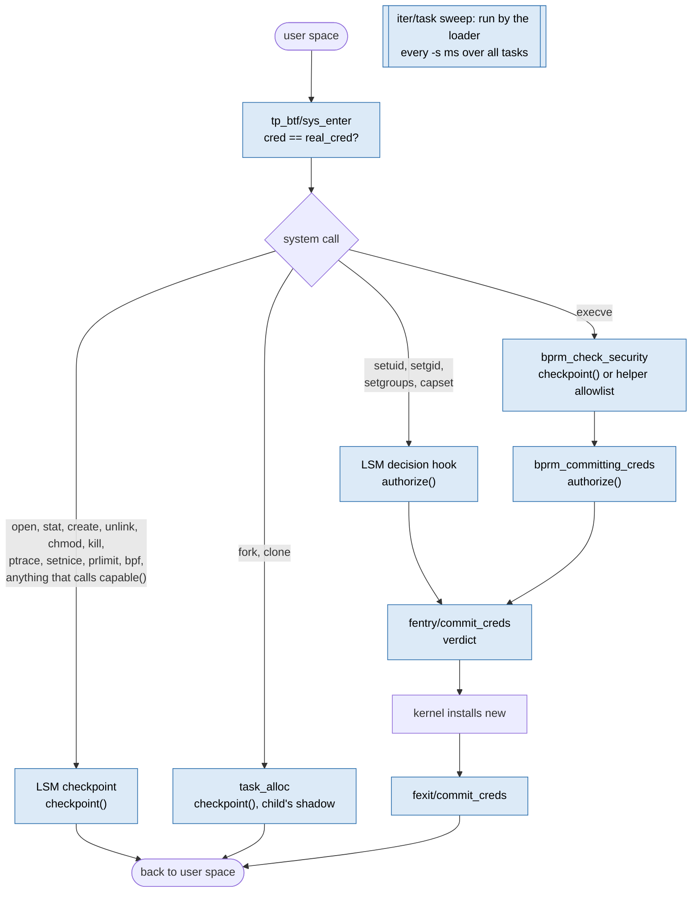

### 4.3 The loader's life cycle

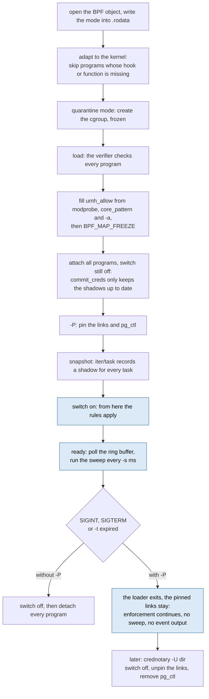

Two orderings in this sequence matter.

**Attach before the snapshot, turn the switch on last.** The programs are attached while the `pg_ctl` switch is off. In that state no rule fires, but `fentry/commit_creds` still records every commit in the shadow. The snapshot then fills the shadows of all other tasks, and only after that does the loader turn the switch on. No task can change credentials between being recorded and being checked.

**Turn the switch off before detaching.** The kernel attaches and detaches programs one at a time. In a window where `commit_creds` is attached but `task_fix_setuid` is not, a legitimate `setuid` would look tokenless. The switch closes that window:
- it starts off, and the loader turns it on after the attach and the snapshot;
- it must be turned off before detaching: at the normal exit of the loader, or with `crednotary -U dir` for a pinned instance;
- with the switch off no rule fires, and `commit_creds` only updates the shadows.

With `-P dir` the links and the switch are pinned in the BPF filesystem. When the loader exits, the programs keep enforcing, but nothing runs the sweep and nothing prints the events.

### 4.4 The shadow

For each task CredNotary keeps, in BPF **task storage**, a *shadow* of the last legitimate state. The storage is created on demand and freed with the task, so there is no per-PID table and no PID-reuse problem. The shadow takes 232 bytes and holds:
- the authorized `real_cred` pointer;
- the 8 uids/gids, `securebits`, the 5 capability sets and `user_ns`;
- for the supplementary groups: the count, an FNV-1a hash of the first 32 GIDs, and whether GID 0 is present;
- the pending token (`auth_cred` and the copy of its contents `auth_v`);
- the flags `flagged` (compromised task), `cred_redirect`, `is_umh` and `committing`.

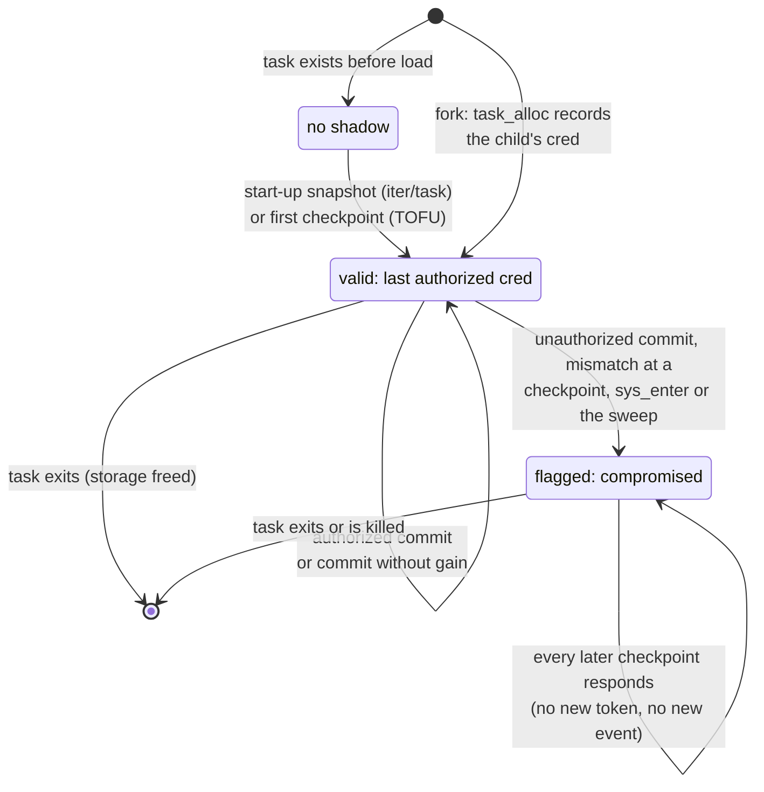

A shadow goes through three states:
- **No shadow.** A task that already exists when CredNotary loads gets its shadow from the start-up snapshot. A task the snapshot misses is recorded at its first checkpoint (trust on first use).
- **Valid.** A new task gets its shadow in `task_alloc` (4.11). An authorized commit, or a commit without a gain, moves the shadow to the new cred.
- **Flagged.** Any detection sets `flagged`. The shadow then stays at the last legitimate state, so every later checkpoint finds the same mismatch and responds. A flagged task gets no new token, and CredNotary emits no further event for it.

### 4.5 Two functions: `checkpoint()` and `authorize()`

Most programs call one of two inline functions.

**`checkpoint(hook)` checks the present.** It reads the task's current `real_cred` and compares pointer and fields with the shadow. On a mismatch it responds according to the mode (4.13) and, the first time, emits `CRED_TAMPER`. It changes nothing, except when it records a task for the first time. It runs in the 27 checkpoint hooks and, through `authorize()`, in the decision hooks.

**`authorize(new, hook)` stamps the future.** It runs only in the five decision hooks, which the kernel reaches after its own permission checks on a credential change have passed. It first calls `checkpoint()`, so a compromised task cannot start a legitimate transition. Then, if the task is not flagged, it deposits a **token**: the pointer `new` plus a copy of its contents.

`fentry/commit_creds`, which every credential change passes through, consumes the token (4.6). Put in notary terms, `authorize()` stamps the new cred and `commit_creds` checks the stamp; at every sensitive operation, `checkpoint()` makes sure the cred in use is the one that was stamped.

| | `checkpoint()` | `authorize()` |
|---|---|---|
| Looks at | the **current** cred, against the shadow | the current cred (through `checkpoint()`), then the **new** one |
| Writes | nothing (except trust on first use) | the token `auth_cred` and `auth_v` |
| Runs in | 27 LSM hooks on sensitive operations, plus the decision hooks | the 5 decision hooks |
| Catches | G2 and G3, at the first use | nothing directly: it makes legitimate transitions recognisable at the commit, and so the illegitimate ones (G1) |

### 4.6 The notary (G1)

**A legitimate transition.** A setuid-root binary run by uid 1000 calls `setuid(0)`:

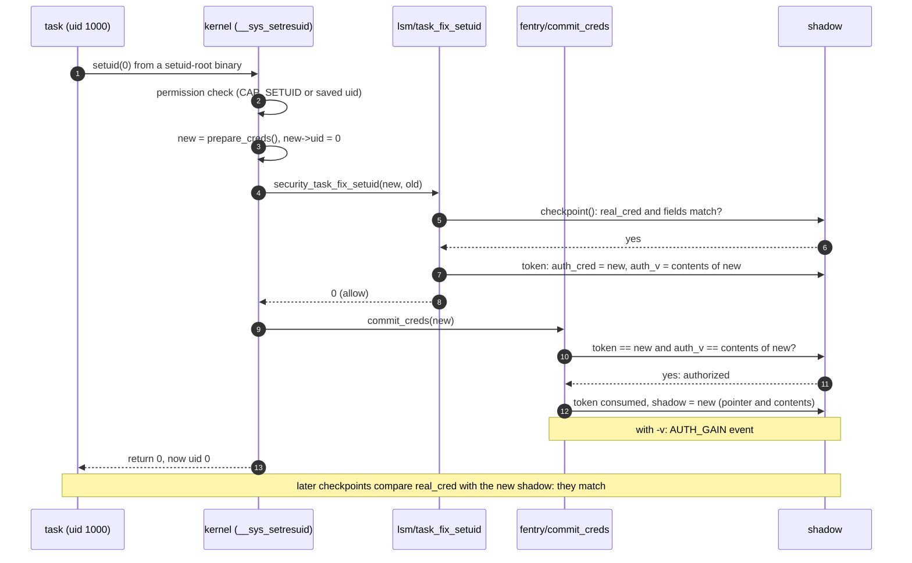

**The verdict at the commit.** In `fentry/commit_creds` CredNotary compares the incoming cred with the **shadow**, not with the outgoing cred. Otherwise an attacker could first raise privileges in place and then make a commit "without a gain": with respect to an outgoing cred that is already root, a root cred adds nothing, while with respect to the shadow (uid 1000) it does.

**What counts as a gain or an identity change:**
- a uid or gid that becomes 0, or GID 0 appearing among the groups;
- **any** change of the 8 IDs or of the groups, also towards another non-root user;
- in the initial namespace:
  - new effective or permitted capabilities;
  - a larger bounding set;
  - inheritable beyond I|P or ambient beyond P&I, that is beyond the limits that `capset` and `PR_CAP_AMBIENT_RAISE` enforce, because at the next `execve` they become real capabilities;
- leaving a child user namespace for the initial one.

**The verdict:**
- **Gain without a token matching `new`** in pointer and contents: emits `UNAUTH_COMMIT` and leaves the shadow unchanged. The reason is `no_token` for ROP, or `token_content_changed` if the approved cred was written after approval. The commit still completes, because fentry cannot stop it, but from then on every checkpoint sees the mismatch.
- **No gain**, for example when privileges are dropped: no token is needed and the shadow is updated.
- **Outgoing cred already different from the shadow** (tampered with before the commit), in a commit that is not already an `UNAUTH_COMMIT`: emits `CRED_TAMPER` with `hook=commit_creds` and reason `real_cred_ptr` or `fields`, and the shadow stays unchanged.
- **In every case** the token is consumed. `fentry/abort_creds` clears it if it refers to a discarded cred, so a future allocation at the same address does not inherit it.

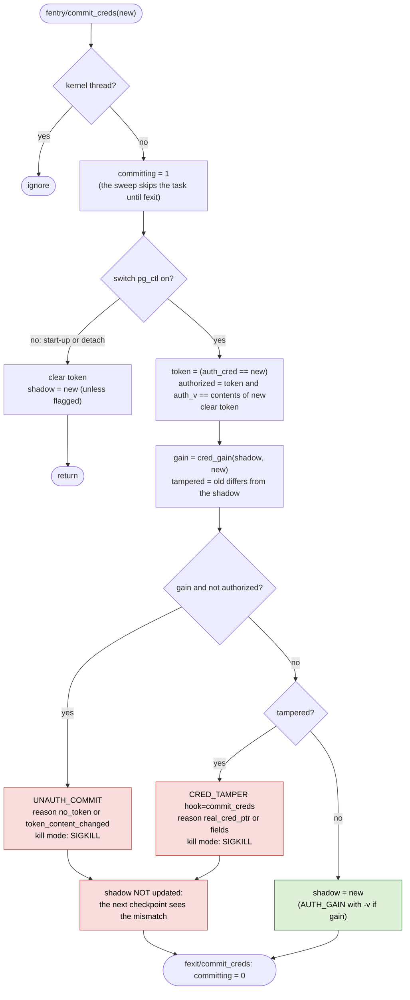

The rule is "no gain without a token", not "no commit without a token". Several legitimate paths call `commit_creds` without passing through a decision hook, for example `unshare(CLONE_NEWUSER)`, dropping a capability from the bounding set with `prctl`, or joining a session keyring. None of them raises privileges with respect to the shadow, so none of them needs a token.

**A ROP payload.** The attacker's chain skips straight to the end of the protocol: it builds a root cred with `prepare_kernel_cred()` and passes it to `commit_creds()`. No decision hook runs, so no token exists for that cred:

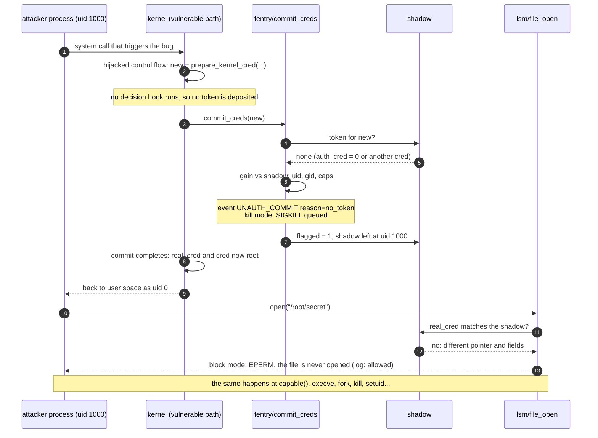

Back in user space, the process is root as far as the kernel is concerned. Each of its operations still passes through a hook that runs `checkpoint()`, and the shadow, which still describes uid 1000, no longer matches. In `block` mode the first use of the privileges fails; in `kill` mode the SIGKILL queued at the commit kills the task on its way back to user space, before it runs any more user code. The task is flagged, so it cannot obtain a token to make a later commit look legitimate either, even in `log` mode.

**A tampered token.** A more careful attacker lets a legitimate transition deposit a token and then rewrites the approved cred between the decision hook and the commit. The token covers the contents of the cred as well as its address, so the commit reports `token_content_changed`.

### 4.7 The checkpoints (G2, G3)

In 32 LSM hooks CredNotary compares the current `real_cred` with the shadow:
- capabilities: `capable`;
- files and execution: `file_open`, `bprm_check_security` (exec), `task_alloc` (fork), the decision hooks;
- inodes (16 hooks):
  - `create`, `link`, `unlink`, `symlink`, `mkdir`, `rmdir`, `mknod`, `rename`;
  - `setattr`, `getattr` (stat), `setxattr`, `removexattr`;
  - `readlink`, `getxattr`, `listxattr`, `get_acl`;
- other tasks: `task_kill`, `ptrace_access_check`, `task_setnice`, `task_setioprio`, `task_setscheduler`, `task_prlimit`;
- `bpf`.

An LSM hook runs *before* the operation. In `block` mode the first use of the stolen privileges therefore fails with EPERM, even though the tampered cred is still installed:
- **different pointer** → swap (G3), reason `real_cred_ptr`;
- **same pointer, different fields** → overwrite (G2), reason `fields`.

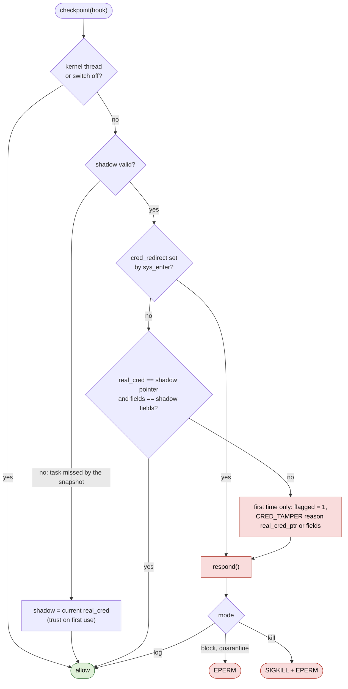

`capable` alone would not be enough: many kernel decisions compare uids directly, for example DAC file permissions or the permission to send a signal, and call `capable` only when the uids do not match.

**Why not `inode_permission`.** It is the generic DAC permission hook, but the kernel calls it for **every component of every resolved path**. Checking it made `stat` on an 8-component path 4.4 times slower. The per-operation hooks fire once, after the DAC check on the parent directory. Only `access()` and `chdir` stay uncovered, because they have no dedicated hook.

### 4.8 The subjective cred (G3)

At the entry of every system call `cred` and `real_cred` must be equal, because legitimate `override_creds` always end before the return to user space. The `tp_btf/sys_enter` tracepoint checks this. If the two pointers differ, it:
- emits `CRED_TAMPER` with reason `cred_redirect`;
- marks the shadow, so every later checkpoint of the task denies.

The checkpoints compare `real_cred` only, so the subjective pointer needs its own check: a redirect of `cred` alone leaves `real_cred`, and the comparison, untouched.

### 4.9 The sweep

A task that sleeps, or computes in user space without system calls, reaches no checkpoint. For this reason, every `-s` milliseconds (default 1000), the loader runs a second `iter/task` iterator that compares **all** tasks with their shadow.
- **In `kill` mode:** it kills the task with the `bpf_send_signal_task` kfunc, because the iterator runs in the loader's context, not in the offending task's. Where the kfunc is missing, the loader sends the SIGKILL when it reads the event.
- **In `quarantine` mode:** the loader reads the event and freezes the process.
- **Tasks in the middle of a commit:** they are skipped. Between `fentry` and `fexit` of `commit_creds` the shadow already names the new cred, but `real_cred` does not yet. The `committing` flag, set in fentry and cleared in fexit, marks this window.
- **Tasks already flagged:** they are skipped too, because they have already been reported and their checkpoints already respond.
- **Subjective cred:** not compared, because a task stopped inside a system call may hold a legitimate override.

### 4.10 G2 and G3 end to end

The three ways of tampering with the cred without `commit_creds` are seen by different programs, but all of them end at a checkpoint:

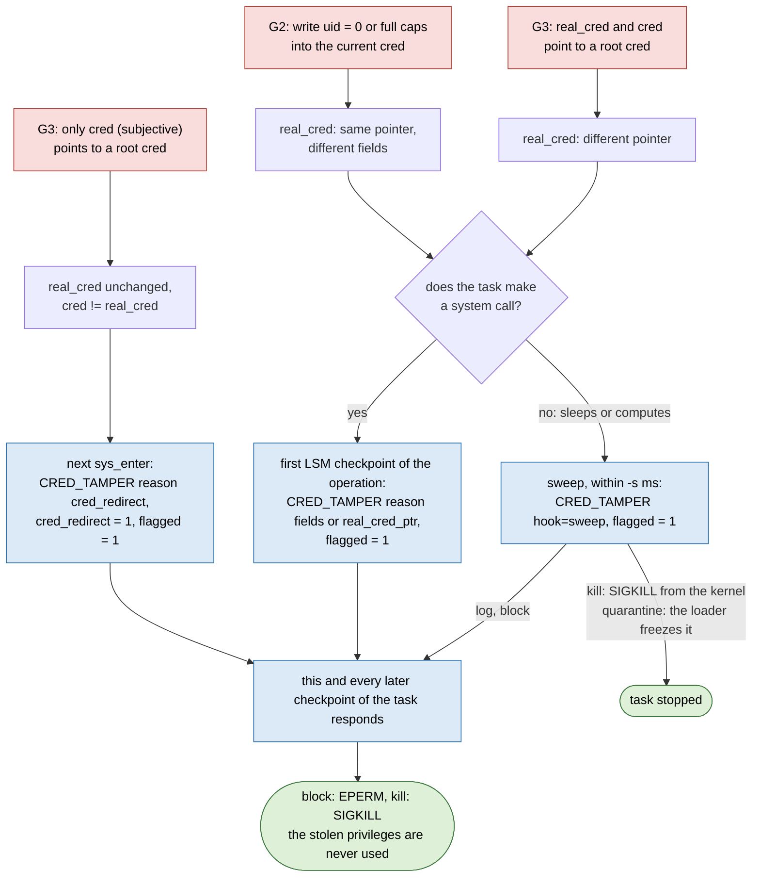

### 4.11 fork

`task_alloc` runs in the parent while the child is being built, after `copy_creds()`. It first runs `checkpoint()` on the parent, so in `block` mode a compromised parent cannot fork. It then gives the child its shadow:
- normally, the child's own cred, which at this point has the same contents as the parent's;
- if the parent is already flagged (possible in `log` mode), the parent's *authorized* state, with the child's cred pointer. The child's cred holds the tampered values, so its first checkpoint flags it too.

A compromised process cannot pass its stolen privileges to a child that looks clean.

### 4.12 Usermode helpers (G4)

- `fentry/call_usermodehelper_exec` records who triggered a helper request for a path outside the allowlist (`UMH_REQUEST`), which helps the investigation.
- `fentry/call_usermodehelper_exec_async` marks the helper thread.
- At its `bprm_check_security`, the helper thread may only execute **allowlisted** binaries. The check uses the path actually executed, so it does not matter how `modprobe_path` was modified.
- The allowlist starts from the *current* value of `/proc/sys/kernel/modprobe`, from `core_pattern` (if it starts with `|`) and from the `-a` options. Then it is **frozen** with `BPF_MAP_FREEZE`: from that moment not even root can modify it from user space.

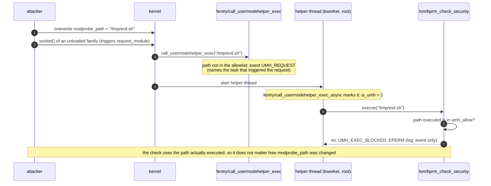

### 4.13 Responses

| Mode | What happens to the offending task |
|---|---|
| `log` | events only |
| `block` | EPERM at every later checkpoint, exec and fork included |
| `kill` | like block, plus SIGKILL: from the checkpoint, from `commit_creds`, from `sys_enter` or from the sweep |
| `quarantine` | in the kernel like block; the loader moves the whole process into a cgroup v2 created frozen (default `/sys/fs/cgroup/crednotary-quarantine`), where it stays stopped and inspectable until an administrator thaws it (`echo 0 > cgroup.freeze`) or kills it |

The first violation flags the task and emits an event; later ones are enforced silently. Quarantine is asynchronous, because a BPF program cannot move a task between cgroups; in the meantime the task's checkpoints already deny.

### 4.14 Self-protection

- **Against the compromised task:** in `block`, `kill` and `quarantine` the checkpoints on `task_kill`, `ptrace_access_check` and `bpf` prevent it from killing or tracing the loader and from opening, detaching or replacing BPF objects.
- **Pins:** with `-P dir` the links are pinned in the BPF filesystem, so protection survives the loader's exit. Removing the pins goes through `inode_unlink`, so it is denied to the compromised task.
- **The `pg_ctl` switch** keeps attach and detach from producing false alarms (4.3).

### 4.15 Performance

- **Direct loads:** on the hot paths creds are read with direct loads through BTF pointers (`t->real_cred->uid.val`), not with `BPF_CORE_READ`, which calls `bpf_probe_read_kernel` for every field. This cuts the cost of a checkpoint by about four times. The only cred read through a helper that remains copies the supplementary GIDs: the array is a flexible member, and BPF cannot index it directly.
- **Per-operation hooks** instead of `inode_permission`: see 4.7.

## 5. Limitations and ways around CredNotary

Section 3 assumes an attacker who goes after the credentials or a helper path and does not care about CredNotary. An attacker who knows CredNotary is running has the routes in the next figure. Red boxes are the attacker's strategies and purple boxes the concrete steps; orange outcomes go undetected, yellow ones are partial.

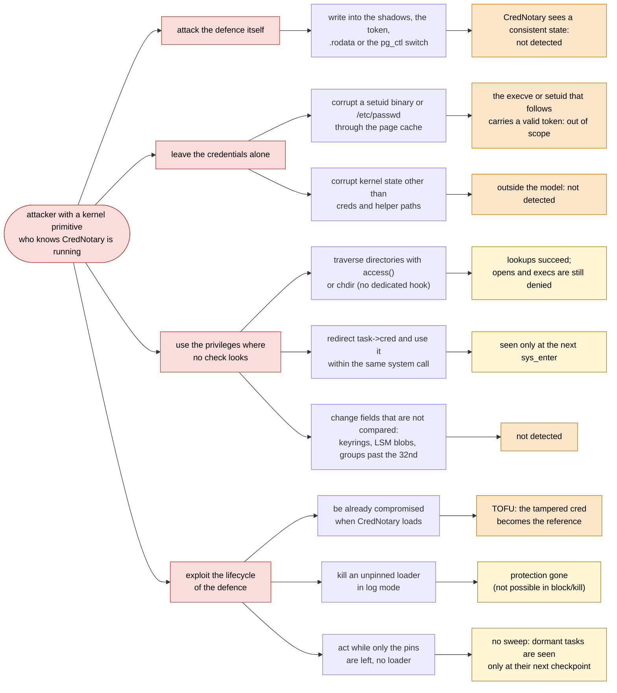

**Attacking the defence itself**
- **Write primitive against the maps:** an attacker who turns the primitive against CredNotary's own maps, shadow, token, `.rodata` or `pg_ctl` switch can alter them, for example to make the shadow say uid 0 or to turn every rule off. Freezing the allowlist protects it only from user space. This limit is shared by every defence that lives in the kernel address space without hardware or hypervisor support, LKRG included.

**Leaving the credentials alone**
- **Legitimate transitions:** attacks that make a legitimate transition grant root, such as corrupting a setuid binary or `/etc/passwd` through the page cache, are out of scope, because the resulting `execve` or `setuid` carries a valid token.
- **Other kernel state:** CredNotary watches the credentials and the binaries executed by usermode helpers. A primitive used against any other kernel state is outside its model.

**Using the privileges where no check looks**
- **Lookups without hooks:** `access()` and `chdir` have no dedicated hook, so a tampered task can traverse protected directories. Opens, execs and operations on contents are covered.
- **Redirect within one system call:** a redirect of `task->cred` made and used *inside* the same system call is seen only at the next one. The checkpoints compare `real_cred`, and `override_creds` is inline and cannot be attached to.
- **Fields not compared:** for groups beyond the 32nd only the count and the hash of the first 32 are compared. Keyrings and LSM blobs are not compared.

**Exploiting the life cycle of the defence**
- **Trust on first use:** a task that is already compromised at load time becomes its own reference.
- **Loader in `log` mode:** in `log` mode an unpinned loader can be killed by a compromised task.
- **Sweep tied to the loader:** the sweep runs only while the loader runs; an instance kept alive by the pins alone has no sweep, so a dormant task is seen only at its next checkpoint.
- **Unordered detach:** if root runs `rm` on the pins, or kills an unpinned loader with SIGKILL, the programs are detached in arbitrary order.

**A property, not a bypass**
- **Detection at use:** CredNotary sees the tampering at the first checkpoint or at the first sweep, so within 1 s, not at the time of the write. If the task never uses the stolen privileges, the attack has no effect.

## 6. Events

One line per event on stdout:

```
[crednotary] UNAUTH_COMMIT hook=commit_creds pid=245 ppid=98 comm=privsim-test uid=1000 euid=1000 -> new uid=0 euid=0 gain=uid,gid,caps,id_change reason=no_token action=denied(-1)
[crednotary] CRED_TAMPER hook=inode pid=246 ppid=98 comm=privsim-test cred uid=0 euid=0 vs shadow uid=1000 euid=1000 ptr_swapped=0 gain=uid,gid,caps,id_change reason=fields action=denied(-1)
[crednotary] UMH_EXEC_BLOCKED path=/tmp/evil.sh pid=256 ppid=12 comm=kworker/u16:0 action=denied(-1)
[crednotary] QUARANTINED tgid=760
```

| Field | Values |
|---|---|
| type | `UNAUTH_COMMIT`, `CRED_TAMPER`, `UMH_REQUEST`, `UMH_EXEC_BLOCKED`, `AUTH_GAIN` (only with `-v`) |
| `hook` | where it was detected: `commit_creds`, `capable`, `file_open`, `bprm_check` (also `bprm_committing_creds`), `task_alloc`, `set*id` (the `task_fix_*` and `capset` decision hooks), `inode`, `task_kill`, `ptrace`, `task_ctl`, `bpf`, `sys_enter`, `sweep`. `UMH_*` events have no `hook` field but `path=` |
| `gain` | `uid`, `gid`, `caps`, `userns_escape`, `id_change` |
| `reason` | `no_token`, `token_content_changed`, `real_cred_ptr`, `fields`, `cred_redirect` |
| `ptr_swapped` | 0 = fields, 1 = `real_cred` swapped, 2 = `cred` redirected |
| `action` | `logged`, `denied(-1)` (EPERM), `SIGKILL` |

## 7. Code map

| File | Contents |
|---|---|
| `src/crednotary.bpf.c` | BPF programs |
| `src/crednotary.c` | loader: options, allowlist, attach, snapshot, sweep, ring buffer, quarantine, pins |
| `src/crednotary.h` | shared types: modes, events, hooks, reasons, gain bits |

In `crednotary.bpf.c`:
- `read_cred` and `read_groups`: reading the cred;
- `credv_eq` and `cred_gain`: comparison and gain computation;
- `checkpoint()`: rule 2;
- `authorize()`: tokens;
- `pg_commit_creds` and `pg_commit_creds_exit`: rule 1 and the `committing` flag;
- `pg_sys_enter`: rule 2b;
- `pg_sweep`: the sweep;
- `pg_snapshot`: the initial snapshot;
- `pg_task_alloc`: the child's shadow;
- `pg_umh_*` and `pg_bprm_check`: rule 3;
- the `PG_INODE_OP` macro: 15 of the 16 inode checkpoints (`pg_inode_setattr` is written separately).

The internal `pg_`/`PG_` prefixes come from the project's earlier name.

**Maps:**
- `shadows`: task storage;
- `events`: 256 KiB ring buffer;
- `umh_allow`: hash, frozen;
- `umh_scratch`: per-CPU, keeps the UMH key off the stack;
- `pg_ctl`: the switch.

**Programs:** 40 in total, that is 32 LSM, 4 fentry, 1 fexit, 1 tp_btf and 2 iter. With `-P`, 38 links plus `pg_ctl` stay pinned.
